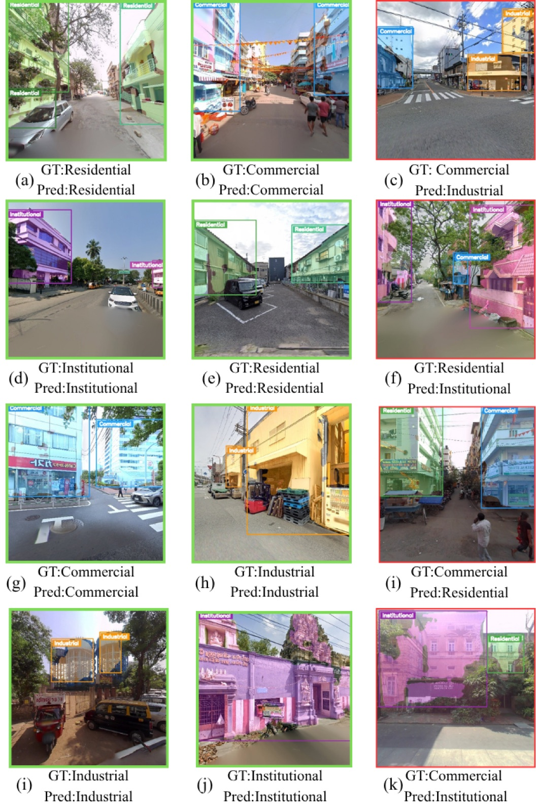

# GeoBuild-SSL

Code for **"Building Instance Usage Mapping in Cross-Cultural Urban
Scenes from Street View Images using Multimodal Self-Supervised Deep Learning"**
(ACM SIGSPATIAL '26).

Shailesh Kachhi, Vaibhav Kumar, Deeksha Arya

[](https://doi.org/10.1145/3841645.3843286)

GeoBuild-SSL predicts the usage class of an individual building (*residential,
commercial, industrial,* or *institutional*) from a single street-view image and
attributes it to its OpenStreetMap footprint for GIS export. It fuses DINOv3
visual features, a monocular-depth geometric prior injected via FiLM, and
multilingual signage (PaddleOCR + frozen CLIP text), trained with a yaw-based
curriculum across six cities in India and Japan.

<p align="center">
  
</p>

## Installation

Requires **Python 3.10**, plus **CUDA 12.1** for GPU training (inference also
runs on CPU/Apple-MPS).

```bash
conda create -n buildingssl python=3.10 -y && conda activate buildingssl

# PyTorch (GPU, CUDA 12.1):
pip install torch==2.5.1+cu121 torchvision==0.20.1+cu121 \
    --index-url https://download.pytorch.org/whl/cu121
# …or CPU / Apple-MPS:
# pip install torch torchvision

pip install -r requirements.txt
pip install git+https://github.com/openai/CLIP.git        # OpenAI CLIP
```

CLIP `ViT-B/32` and Depth Anything V2 are fetched automatically on first run.

## Pretrained weights

Weights live on **Google Drive**, not in git. After cloning, place them under
`final_models/`:

```
final_models/
├── ssl_model/dinov3_rgbd_ssl.pth          # SSL backbone      (≈1.2 GB)
├── detection_model/best.pth               # building detector (≈1.2 GB)
└── classification_model/v5_best.pth       # usage classifier  (≈1.2 GB)
```

The [Drive folder](https://drive.google.com/drive/folders/1AUfRtd3mhPr-d3afXLTwBFB_oL_kp0uM)
mirrors this layout, so [`gdown`](https://github.com/wkentaro/gdown) drops
everything into place:

```bash
pip install gdown
gdown --folder "https://drive.google.com/drive/folders/1AUfRtd3mhPr-d3afXLTwBFB_oL_kp0uM" -O final_models/
```

Inference needs only the three files above. The DINOv3 ViT-L/16 base
(`dinov3_vitl16_pretrain_lvd1689m`, from [Meta DINOv3](https://github.com/facebookresearch/dinov3))
is needed **only** to re-run SSL pretraining or the annotation pipeline; place it
at `final_models/dinov3_weights/`.

## Inference

```bash
python -m src.inference.geobuild_inference --image  path/to/street_view.jpg --output results/
python -m src.inference.geobuild_inference --folder path/to/images/         --output results/
```

Attribute predictions to OpenStreetMap footprints and export a usage map:

```bash
python -m src.inference.gis_mapping
```

<p align="center">
  
</p>

## Training

```bash
# 1. RGB-D self-supervised pretraining of the DINOv3 + depth backbone
python -m src.ssl.train_ssl_rgbd_dinov3

# 2. Five-stage automatic annotation pipeline (generates training labels)
python -m src.annotation.annotate

# 3. Usage classifier with depth-map FiLM and the yaw curriculum
#    --stage 0/1/2 = Easy (15 ep) / Easy+Medium (15 ep) / all bands (20 ep)
python -m src.classification.train_v5_curriculum \
    --stage     0 \
    --train_csv data/annotations/clean_train_labels.csv \
    --val_csv   data/annotations/clean_val_labels.csv \
    --out_dir   outputs/checkpoints
```

Configuration defaults are in [`src/configs/`](src/configs/).

## Evaluation

```bash
python -m src.evaluation.clean_retrain_eval
```

Reports weighted-F₁, macro-F₁, per-class and per-country F₁ on the
panorama-level clean split.

| Config. | weighted F₁ | macro F₁ | Res. | Com. | Ind. | Inst. |
|---|---|---|---|---|---|---|
| RGB                | 0.40 | 0.31 | 0.19 | 0.53 | 0.35 | 0.18 |
| RGB + depth        | 0.65 | 0.49 | 0.46 | 0.83 | 0.43 | 0.24 |
| **RGB + FiLM**     | **0.67** | **0.52** | **0.53** | **0.84** | **0.45** | **0.24** |
| RGB + FiLM + text  | 0.66 | 0.50 | 0.49 | 0.83 | 0.43 | 0.26 |

<p align="center">
  
</p>

## Data

Released label CSVs are in [`data/annotations/`](data/annotations/), split at the
panorama level so no building or panorama is shared across splits:

| Split | Instances | File |
|---|---|---|
| Train | 22,091 | `clean_train_labels.csv` |
| Val   | 2,616  | `clean_val_labels.csv` |
| Test  | 2,899  | `clean_test_labels.csv` |

Derived from 118 Google Street View panoramas across Mumbai, Delhi, Chennai,
Bengaluru, Tokyo, and Osaka. The test split is human-verified. Underlying
imagery is not redistributed here.

## Citation

```bibtex
@inproceedings{kachhi2026geobuildssl,
  author    = {Kachhi, Shailesh and Kumar, Vaibhav and Arya, Deeksha},
  title     = {Building Instance Usage Mapping in Cross-Cultural Urban Scenes
               from Street View Images using Multimodal Self-Supervised Deep Learning},
  booktitle = {The 34th ACM International Conference on Advances in Geographic
               Information Systems (SIGSPATIAL '26)},
  year      = {2026},
  address   = {Riverside, CA, USA},
  publisher = {ACM},
  doi       = {10.1145/3841645.3843286}
}
```

## Acknowledgements

Supported by the PUSHPAK National Mission on Drone Technology (No. 23 (1)/2024-ESDA),
MeitY, Government of India, and ANRF Project No. CRD/2024/000883.

Built on DINOv3, SimCLR, Depth Anything V2, SAM 3, FCOS, PaddleOCR, CLIP,
OpenStreetMap, the India Driving Dataset, and Mapillary Vistas.

## License

[Apache 2.0](LICENSE). Weights are for research use.
