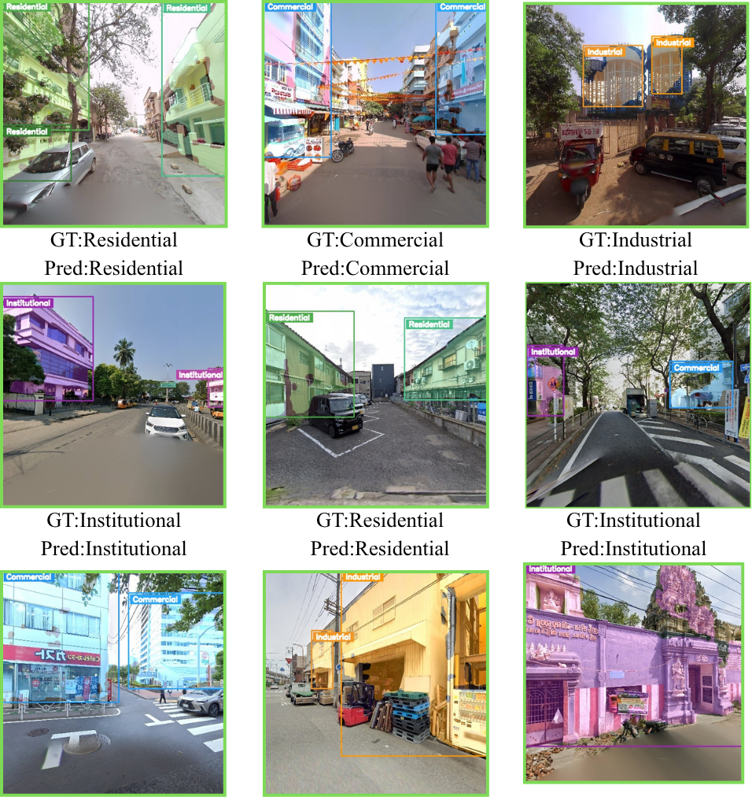

# GeoBuild-SSL

**Building Instance Usage Mapping in Cross-Cultural Urban Scenes from Street View Images using Multimodal Self-Supervised Deep Learning**

GeoBuild-SSL predicts the usage class of an individual building (*residential,
commercial, industrial,* or *institutional*) from a single street-view image,
and attributes the prediction to its OpenStreetMap footprint for GIS export. It
fuses three complementary streams: visual features (DINOv3), a geometric prior
from monocular depth (injected via FiLM), and multilingual signage (PaddleOCR +
a frozen CLIP text encoder), trained with a yaw-based curriculum across six
cities in India (Mumbai, Delhi, Chennai, Bengaluru) and Japan (Tokyo, Osaka).

📄 **Paper:** link will be updated when published (ACM SIGSPATIAL '26).

<p align="center">
  <br>
  <em>Qualitative predictions across the four usage classes and several cities.
  </em>
</p>

## Installation

Requires **Python 3.10**, plus **CUDA 12.1** for GPU training (inference also
runs on CPU/Apple-MPS).

```bash
conda create -n buildingssl python=3.10 -y && conda activate buildingssl

# PyTorch (GPU, CUDA 12.1):
pip install torch==2.5.1+cu121 torchvision==0.20.1+cu121 \
    --index-url https://download.pytorch.org/whl/cu121
# …or CPU / Apple-MPS:
# pip install torch torchvision

pip install -r requirements.txt
pip install git+https://github.com/openai/CLIP.git        # OpenAI CLIP
```

Verify the install:

```bash
python -c "import torch, timm, clip; print('torch', torch.__version__, 'OK')"
```

CLIP `ViT-B/32` and Depth Anything V2 are fetched automatically on first run.

## Pretrained weights

Weights are distributed through **Google Drive** rather than tracked in git.
After cloning, place them under `final_models/` in the layout below. The
inference code resolves these paths relative to the repo root:

```
final_models/
├── ssl_model/dinov3_rgbd_ssl.pth          # SSL backbone      (≈1.2 GB)
├── detection_model/best.pth               # building detector (≈1.2 GB)
└── classification_model/v5_best.pth       # usage classifier  (≈1.2 GB)
```

The **[Google Drive folder](https://drive.google.com/drive/folders/1AUfRtd3mhPr-d3afXLTwBFB_oL_kp0uM)**
mirrors this layout, so [`gdown`](https://github.com/wkentaro/gdown) drops
everything into place:

```bash
pip install gdown
gdown --folder "https://drive.google.com/drive/folders/1AUfRtd3mhPr-d3afXLTwBFB_oL_kp0uM" -O final_models/
python -c "import torch; torch.load('final_models/classification_model/v5_best.pth', map_location='cpu'); print('OK')"
```

Inference needs only the three files above. The third-party DINOv3 ViT-L/16 base
(`dinov3_vitl16_pretrain_lvd1689m`, from [Meta DINOv3](https://github.com/facebookresearch/dinov3))
is required **only** to re-run SSL pretraining or the annotation pipeline; place
it at `final_models/dinov3_weights/`.

## Inference

The full pipeline (detecting buildings, estimating depth, reading signage, and
classifying) runs on a single street-level image or a folder of images:

```bash
python -m src.inference.geobuild_inference --image  path/to/street_view.jpg --output results/
python -m src.inference.geobuild_inference --folder path/to/images/         --output results/
```

To attribute predictions to OpenStreetMap footprints and export a usage map:

```bash
python -m src.inference.gis_mapping
```

## Training

```bash
# 1. RGB-D self-supervised pretraining of the DINOv3 + depth backbone
python -m src.ssl.train_ssl_rgbd_dinov3

# 2. Five-stage automatic annotation pipeline (generates training labels)
python -m src.annotation.annotate

# 3. Usage classifier with depth-map FiLM and the yaw curriculum
python -m src.classification.train_v5_curriculum \
    --stage     0 \
    --train_csv data/annotations/clean_train_labels.csv \
    --val_csv   data/annotations/clean_val_labels.csv \
    --out_dir   outputs/checkpoints
```

Configuration defaults are in [`src/configs/`](src/configs/).

## Evaluation

```bash
python -m src.evaluation.clean_retrain_eval
```

Reports weighted-F₁, macro-F₁, per-class F₁ and per-country F₁ on the
panorama-level clean split (`data/annotations/clean_test_labels.csv`), in which
no panorama or building instance is shared between training and test.

## Repository structure

```
geobuildssl_public/
├── assets/                        Figures used in this README
├── data/
│   └── annotations/               Released label CSVs 
├── final_models/                  Weight layout (download targets; weights not in git)
│   ├── ssl_model/
│   ├── detection_model/
│   ├── classification_model/
│   ├── dinov3_weights/
│   └── ocr_model/
├── src/
│   ├── ssl/                       RGB-D DINOv3 self-supervised pretraining (SimCLR)
│   ├── annotation/                Five-stage automatic label pipeline (annotate.py)
│   ├── classification/            Usage classifier: depth-map FiLM, yaw curriculum
│   ├── depth/                     Monocular depth (Depth Anything V2) utilities
│   ├── detection/                 Building detection / segmentation heads (FCOS)
│   ├── ocr/                       Multilingual signage OCR (PaddleOCR) + CLIP text
│   ├── evaluation/                Clean-split retraining and per-class / per-country evaluation
│   ├── inference/                 End-to-end pipeline, OSM attribution, GIS map export
│   ├── configs/                   Experiment configs
│   └── utils/                     Shared helpers
├── requirements.txt
├── LICENSE
└── README.md
```

## Acknowledgements

Built on a number of open models and datasets, whose authors and maintainers we
gratefully acknowledge: DINOv3 and SimCLR (self-supervised visual representation),
Depth Anything V2 (monocular depth), the Segment Anything Model (instance masks),
FCOS (detection), PaddleOCR (multilingual text), and CLIP (shared text embedding).
We also acknowledge OpenStreetMap and its contributors for the building footprints,
and the India Driving Dataset, Mapillary Vistas, and Google Street View for the
underlying street-level imagery. Developed at the IISER Bhopal GeoAI4Cities Lab.

## License

Released under the [Apache License 2.0](LICENSE). The released model weights are
intended for research use. The annotations are derived from third-party imagery
whose terms govern any redistribution of the underlying images.
